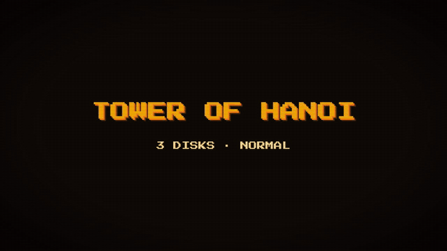
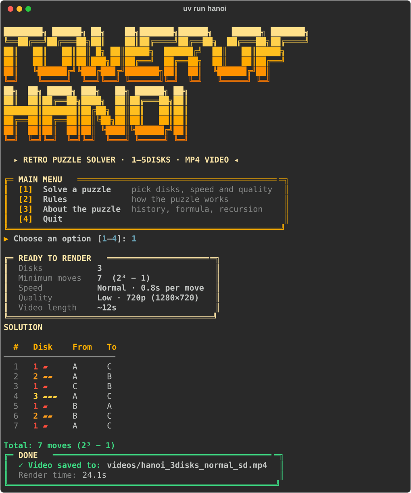

# tower-of-hanoi

A retro-styled command-line app that solves the **Tower of Hanoi** for 1–5 disks, prints every move, and renders a smooth MP4 video of the solution.



Pick the number of disks, a speed and a quality. The app solves the puzzle with recursion, checks every move against the rules, prints the full move list, and renders the video with [Remotion](https://www.remotion.dev). When it's done, it shows where the video was saved.



## Features

- Retro amber-CRT terminal UI with menus, Rules and About screens (built with [Rich](https://github.com/Textualize/rich))
- Solves 1–5 disks in the minimum **2ⁿ − 1** moves; an independent rule checker verifies every move before rendering
- Smooth video: each move lifts, slides and drops with easing, with a live `MOVE 5 / 15 · DISK 1 · A → C` counter
- Intro title card and a `SOLVED!` outro
- Three speeds and two qualities:

  | Speed | Time per move | | Quality | Resolution |
  |---|---|---|---|---|
  | Slow | 1.5 s | | Low | 720p (1280×720) |
  | Normal | 0.8 s | | High | 1080p (1920×1080) |
  | Fast | 0.4 s | | | |

- Works offline after setup (the pixel font is bundled)

## Prerequisites

| Tool | Why | Install |
|---|---|---|
| [Git](https://git-scm.com) | Clone the repo | git-scm.com |
| [uv](https://docs.astral.sh/uv/getting-started/installation/) | Runs the Python app (installs Python for you) | docs.astral.sh/uv |
| [Node.js](https://nodejs.org) (LTS) | Required by Remotion | nodejs.org |
| [pnpm](https://pnpm.io/installation) | Installs the video renderer's packages | pnpm.io/installation |

Check them with:

```bash
uv --version
node --version
pnpm --version
```

## Install

```bash
git clone https://github.com/<your-username>/tower-of-hanoi.git
cd tower-of-hanoi
uv sync
cd video
pnpm install
cd ..
```

`uv sync` sets up Python and the app. `pnpm install` sets up Remotion.

## Run

```bash
uv run hanoi
```

Then choose **Solve a puzzle** → number of disks → speed → quality → confirm.

Videos are saved in `videos/` as `hanoi_<n>disks_<speed>_<sd|hd>.mp4`, for example `videos/hanoi_4disks_normal_hd.mp4`. Rendering the same settings again overwrites the old file.

> The **first** render takes longer: Remotion downloads its own headless browser once (about 100 MB).

## How it works

```
uv run hanoi  (Python + Rich)
   │  menus, input checks
   ├─▶ solver.py   recursive solve(n) → list of moves
   ├─▶ engine.py   replays every move on real rods; refuses illegal ones
   └─▶ renderer.py writes .cache/props.json
                   runs: pnpm exec remotion render src/index.ts Hanoi … --props=… --scale=1|1.5
                           │
                           ▼
        video/  (Remotion + React + TypeScript)
          timeline.ts works out where every disk is on each frame
          components draw the rods, disks, label and cards
                           │
                           ▼
        videos/hanoi_<n>disks_<speed>_<sd|hd>.mp4
```

**The algorithm.** To move *n* disks from A to C: move the top *n − 1* disks to B, move the largest disk to C, then move the *n − 1* disks from B onto it. That takes **2ⁿ − 1** moves, time **O(2ⁿ)** and space **O(n)**.

**One source of truth.** Every timing number (frames per move, intro, pause, outro) lives in `src/hanoi/config.py`. Python sends them to Remotion in the props, so the two sides never get out of sync.

Preview the animation while editing it:

```bash
cd video
pnpm studio
```

More detail lives in [`docs/`](docs): [PRD](docs/PRD.md), [SRS](docs/SRS.md), [tech stack](docs/TECH_STACK.md), [project structure](docs/PROJECT_STRUCTURE.md) and [build phases](docs/PHASES.md).

## Troubleshooting

| Problem | Fix |
|---|---|
| "Node.js is not installed" / "pnpm is not installed" | Install it (see [Prerequisites](#prerequisites)), then open a **new** terminal so it's on your PATH. |
| "Remotion dependencies are not installed" | Run `cd video && pnpm install`. |
| "Render failed." | The last lines of Remotion's output are shown; the full log is in `.cache/render.log`. |
| First render seems stuck | It's downloading Remotion's headless browser. Give it a few minutes on a slow connection. |
| Windows: "Failed to launch the browser process … ENOENT" | The project folder path is too long. Remotion's browser lives about 110 characters deep inside `video/`, and Windows refuses paths over 260 characters. Clone into a shorter folder (e.g. `C:\code\tower-of-hanoi`), then run `pnpm install` again. |
| Can't write to `videos/` | Check folder permissions, or that a sync tool (e.g. OneDrive) isn't locking the folder. |
| Linux: browser fails to start | Install the system libraries below. |

**Linux libraries.** Minimal Linux installs may be missing libraries that Remotion's headless browser needs. On Ubuntu 24.04+:

```bash
sudo apt install -y libnss3 libdbus-1-3 libatk1.0-0 libasound2t64 libxrandr2 libxkbcommon-dev libxfixes3 libxcomposite1 libxdamage1 libgbm-dev libcups2 libcairo2 libpango-1.0-0 libatk-bridge2.0-0
```

On Debian or older Ubuntu, use `libasound2` instead of `libasound2t64`. For other distributions see [Remotion's Linux dependencies page](https://www.remotion.dev/docs/miscellaneous/linux-dependencies).

## Future ideas

- Play mode: you make the moves and the app checks the rules
- Step-by-step terminal mode (press Enter for each move)
- Show the recursion tree beside the towers in the video
- Custom source and destination rods
- Background music and move sound effects

## License

MIT. See [LICENSE](LICENSE).

The video renderer uses [Remotion](https://www.remotion.dev), which is free for individuals and teams of up to 3 people ([Remotion license](https://www.remotion.dev/license)). The [Press Start 2P](https://fonts.google.com/specimen/Press+Start+2P) font is under the SIL Open Font License (`video/public/fonts/OFL.txt`).
